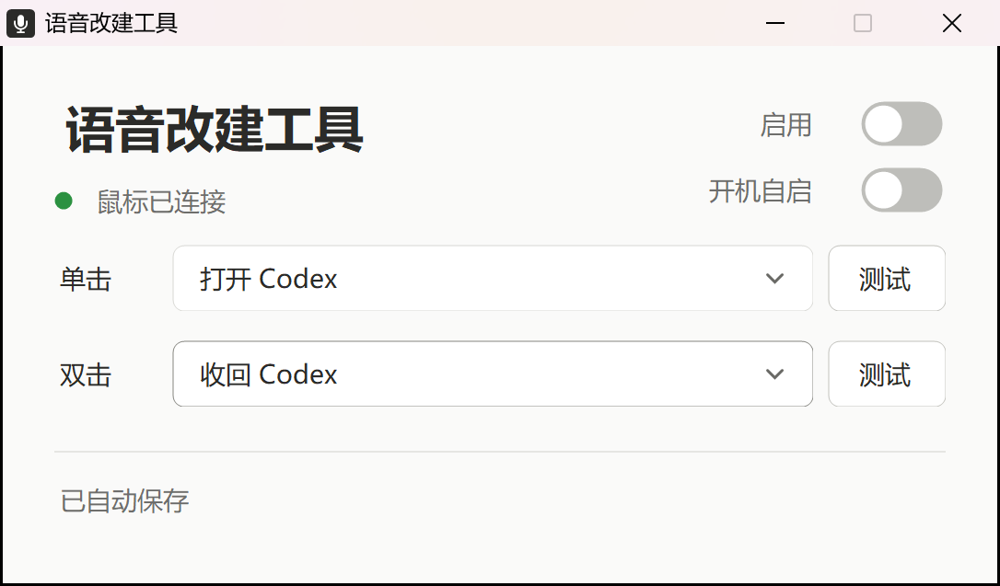

# Cheerdots 专用语音改建工具

为 **Cheerdots 智能鼠标的语音按键**设置单击、双击动作，支持桌面 GRND 和空中 AIR 模式。与 Cheerdots 官方软件一起运行，鼠标基础功能继续由官方软件处理。

这是第三方工具，当前以试用版提供。它只处理已识别的 Cheerdots 目标鼠标，不用于其他品牌鼠标。

## 下载和使用

1. 在 [Releases](https://github.com/Bob-Bo1/cheerdots-voice-key-remap/releases) 下载 `Cheerdots-Voice-Key-Remap-v0.1.0-win-x64.zip`。
2. 解压到有写入权限的固定目录，双击 **语音改建工具.exe**，无需安装。
3. 保持 Cheerdots 官方软件运行，并选择 **语音转文字**。
4. 分别配置单击、双击，再打开“启用”。修改会自动保存，不需要点击保存按钮。

需要 Windows x64 和 .NET Framework 4.8。当前已在 Windows 11 x64 本机使用；其他电脑、其他官方软件版本尚未完成实测。首次运行时，单击默认“打开 Codex”，双击默认“未设置”，启用和开机自启默认关闭。



## 可配置动作

| 动作 | 设置方式 |
| --- | --- |
| 打开 Codex | 自动查找，无需填写安装路径 |
| 收回 Codex | 将已有 Codex 窗口最小化；未运行时不启动 |
| 打开微信 | 自动查找已安装的微信 |
| 快捷键 | 手动输入，或点击“录入按键”后输入组合键 |
| 打开应用程序 | 选择 `.exe` 程序或指向有效 EXE 的 `.lnk` 快捷方式 |
| 未设置 | 不执行自定义动作 |

每行的“测试”按钮会立即执行该行当前动作。快捷键录入仅在工具内生效，不注册全局键盘监听。

例如打开 WorkBuddy：选择“打开应用程序”，点击“选择文件”，找到 WorkBuddy 的 EXE 或快捷方式，等待显示“已自动保存”，再点击“测试”。

## 后台与开机自启

- 关闭窗口会进入右下角托盘；从托盘可以打开设置、停用和退出。
- “开机自启”位于“启用”下方。打开后，下次登录 Windows 在后台运行并自动启用已保存配置，不显示设置窗口或启用确认框。
- 官方软件或原鼠标未就绪时静默等待；发现多个未绑定候选时，需要打开设置选择鼠标。
- 开启开机自启后请保持程序目录固定。移动目录后，重新关闭再打开“开机自启”以更新路径。
- 取消“开机自启”会移除本工具启动项；托盘“停用”仅停止本轮接收。

退出或删除工具前，可以先关闭“开机自启”。本工具不安装输入过滤驱动，不修改官方程序和鼠标固件。

## 配置与记录

配置自动保存在程序旁的 `user-data` 目录。更新时退出工具，保留该目录，再替换 EXE。未填写完整的组合键或路径会保存为草稿，并提示补全；保存失败会明确提示并停用接收。

工具从官方现有日志中提取目标语音按键控制帧，不保留语音、聊天或转写内容。运行记录有数量上限，可从托盘“运行记录”查看。分享问题报告时，请先检查其中的设备信息与本机路径。

## 当前验证范围

- 本机用户已确认：GRND、AIR 下，单击打开 Codex、双击收回 Codex均正常，官方语音界面未同时出现。
- 自动保存、草稿、重开、关闭前保存、失败恢复、托盘和界面布局通过软件检查。
- 自启注册/移除、隐藏启动、设备等待和后台自动启用已检查；真正重启登录后的效果尚待实测。
- 微信/其他应用的所有窗口状态、长期运行、完整断连重连流程、另一台电脑仍待进一步实测。

本工具依赖官方日志格式；官方软件升级或关闭日志后，可能需要适配。它无法自行取消官方原动作：如果自定义动作与官方界面同时出现，请先停用，再反馈官方版本及现象。

## 从源码构建

仓库仅包含当前语音按键工具，不包含早期驱动实验、私有配置或真实设备采集记录。测试中的设备地址为虚构样例。

在 Windows PowerShell 中执行：

```powershell
powershell.exe -NoProfile -ExecutionPolicy Bypass -File .\Build.ps1
```

默认输出到 `app`，构建过程执行界面、配置、日志、单双击分发及自启检查，最后生成 `app\语音改建工具.exe`。无需下载 NuGet 依赖。

源码目录：`src` 为当前界面与日志动作；`shared` 为设备元数据识别、快捷键及 Codex 窗口处理；`assets` 为程序图标。所有生成的 `user-data` 和检查输出均被 Git 忽略。
